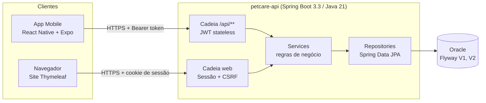
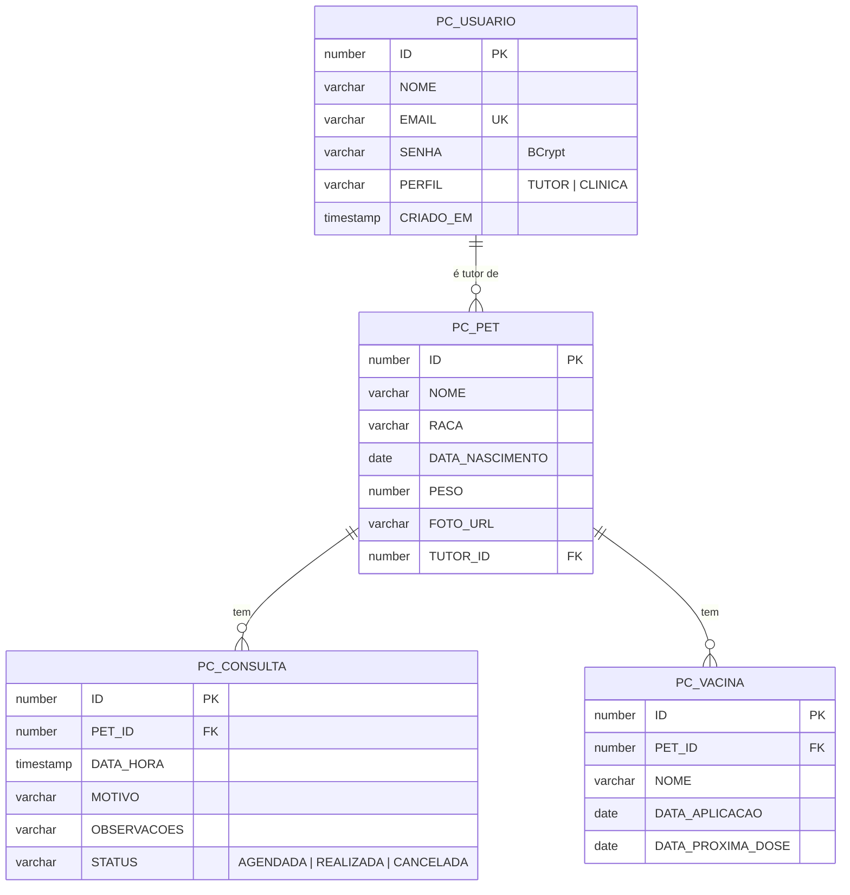
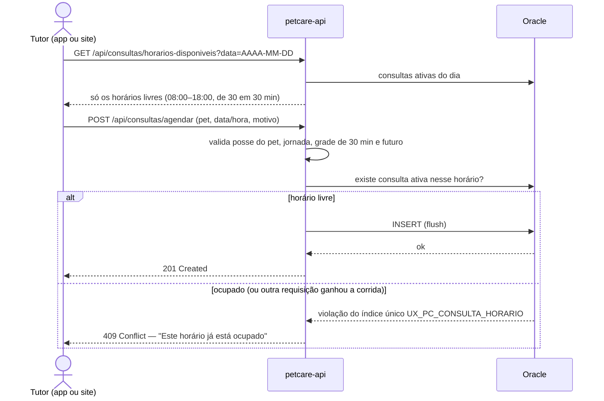

# Arquitetura e evidências — PetCareIA+

Este documento reúne as evidências técnicas pedidas na Sprint 4 (documentação, modelo de dados, scripts SQL e fluxos).

## 1. Visão geral

Os dois clientes usam **os mesmos services**: a regra de agendamento, de vacina e de posse dos dados existe uma vez só.

## 2. Modelo de dados (Oracle)

Scripts SQL versionados: `src/main/resources/db/migration/`
- `V1__criar_tabelas_core.sql` — tabelas, chaves e checks.
- `V2__horario_unico_consulta.sql` — índice único **parcial** (só consultas não canceladas ocupam o horário).

## 3. Fluxo de agendamento (e como evitamos horário duplicado)

## 4. Segurança

| Camada | Regra |
|--------|-------|
| `/api/**` | JWT (access 1 h + refresh 7 dias); sem token → 401; sem permissão → 403 |
| Web | Sessão com CSRF; logout por POST |
| Perfis | `TUTOR` só enxerga os próprios pets; `CLINICA` enxerga tudo, marca consulta como realizada e cadastra novas clínicas |
| Cadastro público | Sempre `TUTOR` (o perfil nunca vem do cliente) |
| Segredos | Somente variáveis de ambiente |

## 5. Decisões de design (para a narrativa)

- **Um backend, dois clientes:** reaproveita regra de negócio e reduz inconsistência entre site e app.
- **Regra crítica no banco:** o índice único parcial protege a agenda mesmo com acessos simultâneos.
- **Oferecer só horários válidos:** o app e o site consultam os horários livres, então o usuário raramente chega ao erro 409.
- **Lembretes no aparelho:** notificações locais derivadas dos dados da API, sem depender de servidor de push.
- **Posse centralizada (`AutorizacaoService`):** uma regra, testada, usada por pets, consultas e vacinas.
